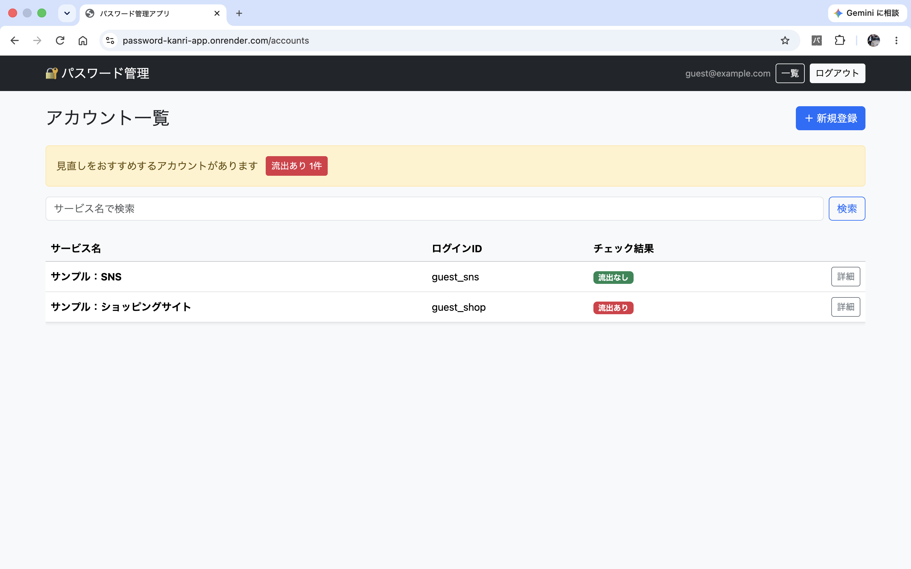
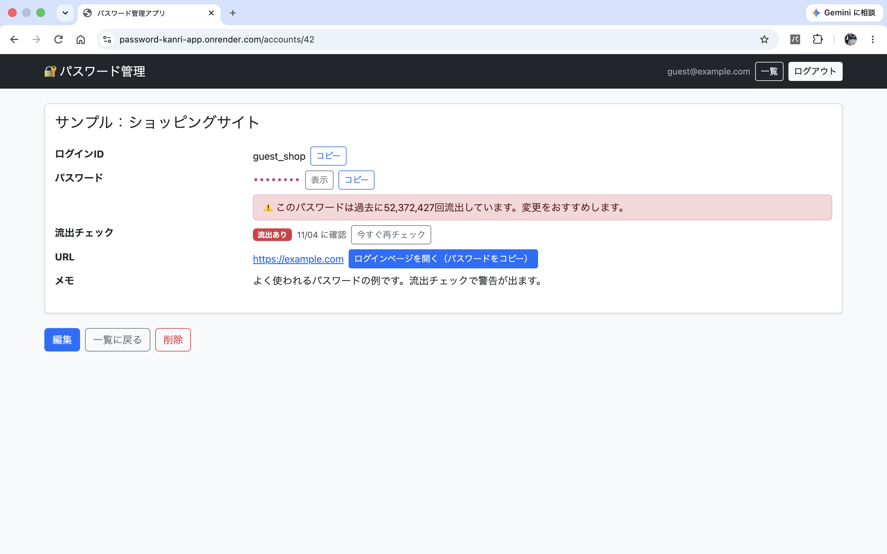
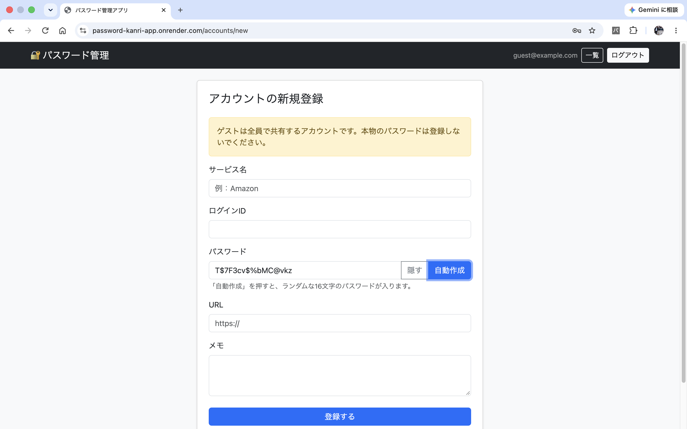
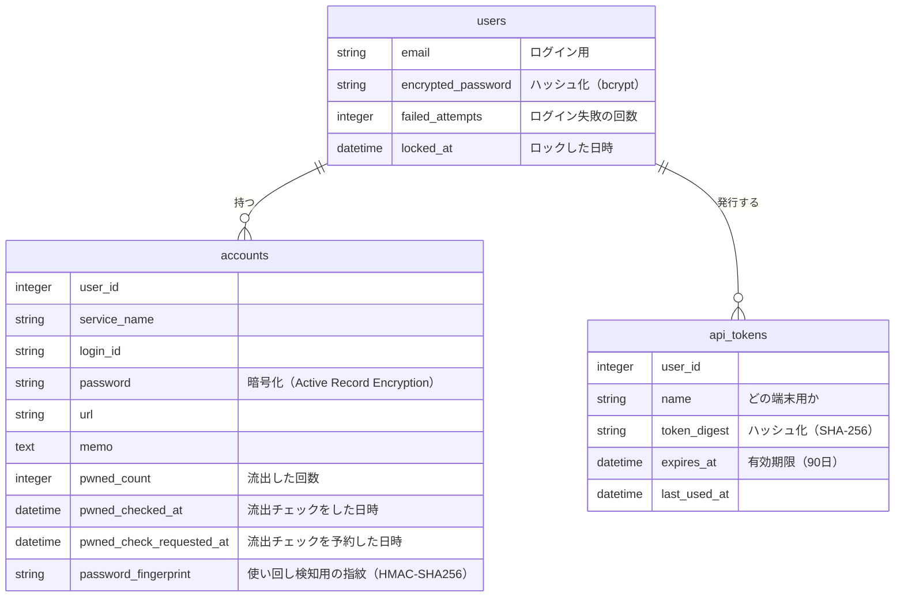
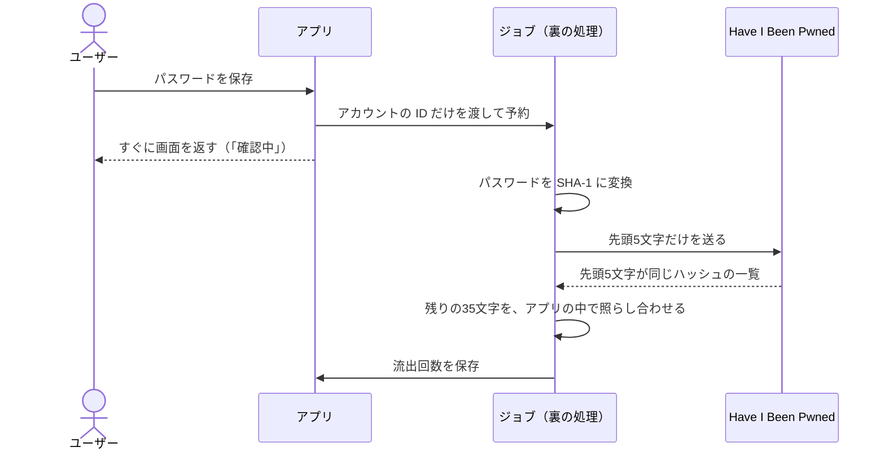

# 🔐 パスワード管理アプリ

サービスごとのログインIDとパスワードを、暗号化してまとめて管理できる Web アプリです。
登録したパスワードが過去に流出していないかを、外部 API を使って自動でチェックします。

**公開URL**：https://password-kanri-app.onrender.com

> トップページの「ゲストログイン」から、登録なしで試せます。
> ※ 学習用のデモアプリです。実際のパスワードは保存しないでください。
> ※ 無料プランのため、しばらく使われていないと最初の表示に30秒〜1分ほどかかります。

| 詳細画面                                                    | 新規登録（パスワードの自動作成）                           |
| ----------------------------------------------------------- | ---------------------------------------------------------- |
|  |  |

## 作った理由

昨今の顧客情報流出のニュースから、パスワードを使い回す危険性と、長く複雑なパスワードを使う必要性を感じて作りました。
あわせて、Ruby on Rails と Web アプリのセキュリティを、手を動かして学ぶことも目的にしています。

## 主な機能

- ユーザー登録・ログイン・ログアウト
- 登録情報（メールアドレス・パスワード）の変更と退会
- ゲストログイン（ログインするたびに、サンプルデータに戻ります）
- サービス名・ログインID・パスワード・URL・メモの登録／編集／削除
- サービス名での検索（大文字・小文字を区別しない）
- パスワードの「表示／隠す」の切り替え
- ログインID・パスワードのコピーボタン
- 登録した URL を開き、同時にパスワードをコピーする「ログインページを開く」
- 強いパスワードの自動作成（16文字のランダムな文字）
- **パスワード流出チェック**（Have I Been Pwned の Pwned Passwords API）。保存したあと裏で調べるので、保存の画面はすぐに返ります。7日たったものは、一覧を開いたときに自動で調べ直します。詳細画面の「今すぐ再チェック」でも、いつでも調べ直せます
- **パスワードの使い回し検知**：同じパスワードを使っているアカウントを、一覧のバッジと詳細画面の注意で知らせます
- **Chrome 拡張機能**：開いているサイトのアカウントを呼び出して、ボタン1つでログインフォームに入力
- 拡張機能は、ショートカットキーでも入力できます
- 拡張機能で、ページに入力した内容を読み取って、新しいアカウントとして登録できます
- 一覧の上に、流出あり・使い回しの件数を表示し、押すとそのアカウントだけにしぼり込める
- コピーしたパスワードは、30秒後にクリップボードから消える（その間に別のアプリに移ったときは消えません）

## 使用技術

| 分類                 | 技術                                                         |
| -------------------- | ------------------------------------------------------------ |
| 言語・フレームワーク | Ruby 4.0.2 / Ruby on Rails 8.1                               |
| 認証                 | Devise（日本語化：devise-i18n）                              |
| 暗号化               | Active Record Encryption                                     |
| フロントエンド       | Bootstrap 5.3 / Stimulus（Hotwire）                          |
| 外部 API             | Have I Been Pwned（Pwned Passwords API）                     |
| データベース         | SQLite（開発環境） / PostgreSQL（本番環境）                  |
| インフラ             | Render                                                       |
| 拡張機能             | Chrome 拡張機能（Manifest V3） / トークン認証の JSON API     |
| テスト               | Minitest                                                     |
| CI                   | GitHub Actions（テスト・Brakeman・bundler-audit を自動実行） |

## テーブル設計

## セキュリティで工夫したこと

### 1. 「ハッシュ化」と「暗号化」の使い分け

| 対象                           | 方式                               | 理由                                         |
| ------------------------------ | ---------------------------------- | -------------------------------------------- |
| アプリへのログインパスワード   | ハッシュ化（bcrypt）               | 本人確認にだけ使うので、元に戻せる必要がない |
| 保存する各サービスのパスワード | 暗号化（Active Record Encryption） | 画面に表示するために、元に戻せる必要がある   |

データベースの中身が漏れても、パスワードはそのままでは読めません。暗号化の鍵は `credentials` で管理し、Git には含めていません。

### 2. 自分のデータだけにアクセスできるようにした

データを探すときは、必ず `current_user.accounts.find(...)` のように、ログイン中のユーザーのデータの中から探しています。
URL の番号を書き換えても、他人のデータは表示されません。
また、送られてきた値（Strong Parameters）から `user_id` を外し、他人のユーザーIDを送り込めないようにしています。

### 3. パスワードを外部に送らない流出チェック

パスワードを SHA-1 でハッシュに変換し、**先頭5文字だけ**を API に送ります（k-匿名性）。
API から返ってきた候補の一覧と、残りの35文字をアプリの中で照らし合わせるので、パスワードそのものは外部に送りません。
チェックは、パスワードを保存したあとに **Active Job で裏で**行います。API の返事を待たずに画面を返すので、保存が遅くなりません。結果はデータベースに保存しているため、画面を開くたびに API を呼ぶことはありません。

- ジョブにはパスワードではなく**アカウントの ID だけ**を渡し、予約の情報やログにパスワードが残らないようにしています
- 流出した情報は日々増えるので、前に調べてから7日たったものは、一覧を開いたときに裏で調べ直します。無料の Render には定期実行（cron）がないため、この形にしました
- 予約した日時を記録して、一覧を何度開いても同じチェックを二重に予約しないようにしています。予約から1時間たっても結果が出ていなければ、もう一度予約します（サーバーの再起動でジョブが消えたときのため）
- 詳細画面のボタンでも、いつでも調べ直せます。調べられなかったときは、前回の結果を残します

### 4. XSS（クロスサイトスクリプティング）対策

登録された URL は、`http://` または `https://` で始まるときだけリンクにしています。
`javascript:` で始まる「URL」をリンクにして、クリックで悪いプログラムが動くことを防ぐためです。

さらに、もう一段の守りとして **CSP（Content-Security-Policy）** を設定しています。ブラウザに「このアプリが読み込んでよいプログラム」を伝え、万一ページに悪いプログラムが入り込んでも動かないようにしています。

### 5. 暗号化したまま、パスワードの使い回しを見つける

暗号化したパスワードは、同じ内容でも毎回違う文字になるので、データベース上で比べられません。
そこで、パスワードから HMAC-SHA256 で「指紋」を作り、指紋どうしを比べています。

- 鍵がないと指紋を計算できず、指紋から元のパスワードにも戻せません。鍵は `secret_key_base` から作り、Git には含めていません
- 指紋にユーザーIDも混ぜているので、別のユーザーと同じパスワードかどうかは分かりません
- `secret_key_base` を変えたときは、`bin/rails accounts:refingerprint` で指紋を作り直します（作り直さないと、エラーは出ないまま使い回しを見つけられなくなるため）

### 6. ゲストユーザーの制限

ゲストユーザーは全員で共有するため、登録情報（メールアドレス・パスワード）の変更と退会をできないようにしています。
拡張機能のトークンも発行できません。
また、ゲストの登録画面には「本物のパスワードは登録しないでください」と注意書きを出しています。

### 7. SQL インジェクション対策と、安全な乱数

- 検索では、キーワードを SQL に直接埋め込まず、プレースホルダ（`?`）と `sanitize_sql_like` を使っています
- パスワードの自動作成には、予測されやすい `Math.random()` ではなく、暗号用の `crypto.getRandomValues()` を使っています

### 8. Chrome 拡張機能との連携

- 拡張機能は、アプリで発行した **API トークン**で認証します。トークンは SHA-256 でハッシュ化して保存し、本物は発行したときに1回だけ表示します。有効期限は90日で、いつでも削除して無効にできます
- API は、先頭の `www.` と大文字・小文字の違いを除いて、登録した URL と**ホスト名が一致する**アカウントだけを返します。`examp1e.com` のような偽サイトには返しません
- 入力は、ユーザーが**ボタンを押したときだけ**行います。権限は `activeTab` にして、ボタンを押したタブだけを操作します
- 入力する直前にもページのホスト名を確かめ、別のサイトに移動していたら入力しません。見えない入力欄には入力しません。
- https:// のページにだけ入力します（試すための localhost は例外です）

### 9. ログインの守り

- ログインに5回失敗すると、15分間ロックします（総当たり攻撃への対策）。ゲストログインは、ロックされても使えるようにしています
- ログインパスワードは12文字以上にしています。すべてのパスワードを守る「親のパスワード」だからです
- 30分操作しないと、自動でログアウトします。「ログインを記憶する」は、自動ログアウトを無効にしてしまうため、あえて外しました
- パスワードが映るページと API の返事には `Cache-Control: no-store` を付け、ブラウザに保存させないようにしています。Turbo の一時保存も止めて、「戻る」で表示中のパスワードが見えたままにならないようにしています
- ログインID・メモ・URL・メールアドレスは、サーバーのログに残らないようにしています

## 苦労したこと

### 1. 公開すると、Render でビルドが失敗した

Render に公開したとき、`ArgumentError: key must be 16 bytes` というエラーでビルドが止まりました。
エラーの内容から「暗号化の鍵の長さが合っていない」と考え、Render に登録した `RAILS_MASTER_KEY` の値を確かめました。
手元の `master.key` は正しい32文字だったので、貼り付けのときに余計な文字が入ったか、一部が欠けたと考えました。
VSCode でファイルを開いてコピーし直したところ、公開できました。
エラー文をそのまま読み、「手元では動くのに本番では動かない」ときは、環境ごとの設定の違いから疑うことを学びました。

### 2. 公開環境でだけ、パスワードが表示されなかった

手元では動くのに、公開環境の詳細画面でだけ、「表示」ボタンを押してもパスワードが見えませんでした。
ボタンの文字は「隠す」に変わっていたので、JavaScript は動いていると判断しました。
ページの HTML を確認するとパスワードも入っていたため、ブラウザのパスワード保存機能が `<input type="password">` に反応していることが原因と考えました。
詳細画面のパスワードは入力するものではないので、入力欄をやめて文字として表示する形に直したところ、解決しました。
「どこまでは正しく動いているか」を1つずつ確かめると、原因をしぼり込めることを学びました。

### 3. Rails を更新したら、Rails の中でエラーが出て起動しなかった

サポートが終わった Rails 7.1 を 8.1 に上げるため、7.2 → 8.0 → 8.1 と1段階ずつ上げ、そのたびにテストを動かしました。
8.1 にしたところ、`anonymous rest parameter is also used within block (SyntaxError)` というエラーで起動しなくなりました。
エラーが出たファイルを見ると、自分のコードではなく Rails の中のファイルだったので、Rails ではなく Ruby の側に原因があると考えました。
調べると、Ruby 3.3.0 には、名前のない引数（`*`）をブロックの中で使う書き方を、間違いとしてはじいてしまうバグがありました。
Ruby を 4.0.2 に上げると起動し、脆弱性の警告も47件から0件になりました。
エラーが「どのファイルで」起きているかを見ると、自分のコード・gem・Ruby のどこを直すべきかをしぼり込めることを学びました。

## Chrome 拡張機能の使い方

1. このリポジトリの `chrome_extension` フォルダを、Chrome の `chrome://extensions` で「パッケージ化されていない拡張機能を読み込む」から読み込みます
2. アプリにログインし、メニューの「拡張機能」でトークンを発行します
3. 拡張機能の「設定」で、アプリの URL とトークンを保存します
4. ログイン画面を開き、ツールバーの拡張機能のボタンから「入力」を押します
5. ショートカットキー（Mac は `option + shift + L`、Windows は `Alt + Shift + L`）でも入力できます。そのサイトのアカウントが1つならすぐに入力し、2つ以上ならポップアップで選べます

試すときは、デモ用のログイン画面（`/login_demo.html`）が使えます。
※ ログインの入力欄が、ページの中に埋め込まれた別のページ（iframe）の中にあるサイトでは、入力できません。

## 今後やりたいこと

- 拡張機能を Chrome ウェブストアで公開できる形に整える
- アカウントを編集したときに、拡張機能の一覧にもすぐ反映させる
- 裏での流出チェックが終わったら、画面を読み込み直さなくても結果が表示されるようにする（Turbo Streams）
